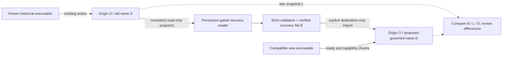

# Data isolation architecture — design for Architect review

2026-10-31 UTC. Issue [#34](https://github.com/jsnwilmot/PrintGuard3D/issues/34), including [Architect kickoff](https://github.com/jsnwilmot/PrintGuard3D/issues/34#issuecomment-6534213614). Approved main/PR #33 merge: **90461bd1f07e0c3fa5ad2807438c920fb3d48a40**. Branch `release1/data-isolation-design`. **PROPOSED DESIGN ONLY. Nothing below is implemented, approved for implementation, or evidence of safe deployment. #16 remains 🔴 RED STOP; Release 1 NOT APPROVED.**

The five-document package is this recommendation, [threat matrix](THREAT-MATRIX.md), [migration/rollback protocol](MIGRATION-ROLLBACK.md), [acceptance test plan](TEST-PLAN.md) and [owner decisions](DECISIONS.md). They do not amend the original 86-row acceptance evidence or previous failing audit.

## Evidence and target property

[PR #33 results](../release1-operational-preflight/RESULTS.json) recorded 30 PASS/12 FAIL plus one human-only NOT VERIFIED disposition. Four scenarios failed in each of Chromium, Firefox and WebKit: pre-Phase-5 writer, pre-recommendation writer, old tab held through worker activation, and native-number-only v30. Earlier logs/observations stayed unchanged in the recorded comparisons, but newly written stale-code completions omitted recommendation provenance and old-code exports were rejected by both readers. The green 242/45/140 baseline did not execute or override this audit. No deployed binaries, real user data or hosting were inspected.

The minimum new property is **known shipped historical code cannot address the new destination with its existing database-opening path**. Source and destination may still diverge. We must neither equate destination isolation with a frozen source nor certify incomplete historical facts by re-exporting them. All future tests/implementation must preserve the original source and show the destination's record hashes unchanged when those exact old executables run.

## Storage model and source facts

Use symbols, not runtime assignments: `O` = retained browser origin/storage context; `S` = existing name `PrintGuard3D`; `D` = one proposed governed isolated destination name, **literal string NOT SELECTED**; `O2` = optional separately approved new origin. Database names must not rotate per build. A deployment path, URL hash, manifest display name, source-host API route or preference key is not a destination selector.

The [HTML origin definition](https://html.spec.whatwg.org/multipage/browsers.html#origin) uses scheme/host/port. [IndexedDB §2.1 and §2.7](https://w3c.github.io/IndexedDB/) associate database names with storage keys and make transactions database-scoped. Thus a distinct name can separate application records without a cross-database atomic cutover. This is a platform-model premise; target browser behavior still needs tests.

The [Storage Standard](https://storage.spec.whatwg.org/) describes origin-based storage keys, quota and persistence. Browser partitioning, private modes and device clearing remain operational constraints; a second same-origin name is not an independent disaster-recovery copy. The [service-worker lifecycle specification](https://w3c.github.io/ServiceWorker/) permits activation with existing clients through skipWaiting; PR #33 directly demonstrates that activation did not replace already-running page JavaScript.

Primary references reviewed **2026-10-31**: IndexedDB editor draft dated 2026-10-30; HTML living standard updated 2026-10-30; Storage updated 2026-10-19; Service Workers nightly draft dated 2026-10-29. Draft/living specifications are not browser-support certification. The project-specific protocol below is an engineering proposal, not a claim that these specifications implement it.

Current [db.ts](../src/db.ts) defaults to `S`, declares Dexie schema 1 then 2/native v20, and exports a global instance. Seven core record stores, `preferences` and `observations` are nine distinct stores. [App.tsx](../src/App.tsx) gates record reads on acknowledgment; [observationStore.ts](../src/observationStore.ts) can write on ordinary app opening after consent. [vite.config.ts](../vite.config.ts) precaches a content-hashed app cache, calls skipWaiting/clients.claim and deletes prior `printguard-*` caches on activation. These facts preclude treating the unmodified current app boot as a strictly read-only recovery reader. No current source is changed by this design.

## Options

| Option | Destination protection against the two tested old binaries | Migration, user burden and compatibility | Offline/PWA, failure and security costs | Assessment |
| --- | --- | --- | --- | --- |
| A: same origin, distinct governed `D` | Known fixed-name open calls continue reaching `S`; they do not select `D`. New code must never fall back to `S` for ordinary writes | Explicit migration permission and strict verified snapshot/file import; source retained. Same bookmark; moderate UX/storage overhead; requires a pure read-only source adapter and destination state control | Shares origin quota/clearing, caches/SW and arbitrary same-origin authority. Old SW may deliver old UI, which must still select only `S`. Stale source writes remain possible | **Recommended candidate if origin retention is required**, conditional on tests and owner decisions |
| B: separate origin `O2`, controlled file transfer, preferably also governed `D` | Known old clients at `O` cannot directly address `O2` storage in the intended browser model | No transparent cross-origin IDB read. User obtains a valid supported-reader backup at `O`, imports at `O2`, renews device acknowledgment and verifies restoration. Highest URL/install/support friction | Stronger storage/SW separation; different permission/install state and host/domain/processor decisions. Same-device loss, related-provider failures and old-source divergence still exist. Safari/iOS/partitioning/install behavior NOT VERIFIED | **Preferred alternative when stronger browser isolation and a new address are acceptable**; no host selected/provisioned |
| C: same-origin staging/copy with coordinator, reader fences and compatibility epochs | If final records remain under `S`, the audited old writers can still reach them: **REJECT**. If final records use `D`, this is A plus extra machinery | Multiple staging DBs, switch pointers and cross-DB recovery increase complexity; a pointer old code ignores is not a barrier | Distributed-looking cutover has no browser-wide atomic switch; current-only locks/epochs cannot compel historical clients | Reject as a standalone substitute; use only narrowly justified destination-local control within A, not per-build DB proliferation |
| Status quo / native-version-only bump | Actual v20/v30 counterexamples already failed | Least UI work, unsafe shared destination | Cache replacement and warnings leave historical writes possible | **REJECT** |

Neither A nor B protects against malicious destination-origin scripts, XSS, extensions, developer tools, physical device owners, manually modified old code or a deliberately hostile native app. A database name is not secret or an ACL. B is stronger against ordinary cross-origin access, but does not establish independent providers, cookie isolation across related domains, legal compliance or resistance to a compromised destination host.

This depicts candidate A only. Source-to-destination transfer is not automatic, source writers are not frozen, and the review box is not permission to merge conflicting history. B instead places the destination at `O2` and uses explicit file transfer; no cross-origin database access is assumed.

## Recommended candidate A: bounded architecture

Choose A only if the owner retains `O`, accepts its shared-origin limits and can support the cutover protocol. Otherwise evaluate B before implementation. No final architecture choice is made by this PR.

1. **Single destination factory.** One reviewed constant selects `D` for every normal read/write/export/notification/observation path, including installed/browser entry points and error recovery. No URL/hash/localStorage override, runtime name supplied by import, automatic source fallback, per-version DB selection or writable alias to `S`. Existing historical filenames and binaries remain unchanged for testing. Fresh users create only `D` after required consent; source detection/migration is separate and optional.
2. **Separate source reader.** After v1.0 device acknowledgment and distinct migration permission, a pure native read-only adapter may inspect explicitly named `S` at the same origin. It must not instantiate the global current app DB, request an upgrade, create a missing source, repair rows, change source preferences/acknowledgment/lastBackup, or start observation collection. Current validation lives beside a global DB in db.ts; extracting/reusing it without bootstrap side effects is a future implementation proof obligation, not a refactor performed here. A missing-source creation/upgrade attempt is aborted. Treat storage enumeration as optional UX, not correctness or browser-support prerequisite. See the protocol for strict validation and unknown stores.
3. **One governed destination with control state.** Propose destination-local operational metadata separate from workshop/history definitions: format version, namespace family, migration ID, source snapshot/file digest, expected target digest, writer capability/epoch, state, last source-check outcome and cutover receipt references. State is not a substitute for isolation. Exact store/key layout, namespace string and native schema version are owner/Architect decisions before implementation. A small dedicated control store is preferred to silently extending strict user `preferences` records. No old source store is added/renamed/modified.
4. **Explicit readiness.** Only compatible cooperating code with the current destination epoch and state READY can write user records. Before READY, imports/verification are restricted operations; background observations, default-profile installation and normal saves stay off. Full payload plus destination receipt enter one destination transaction; fresh readback and user review precede READY. An interrupted verification leaves a recoverable locked destination, not a hidden automatic fallback to `S`.
5. **Preserved contract.** Keep every original record ID, owner, source/profile version, decision, historical log, observation and embedded image; no interval changes or expiry. Re-evaluate only active trust claims through existing exact-model verification, display permitted quarantine differences, and never rewrite accepted historical definitions or logs. Historical missing fields remain missing/unknown. Existing perpetual engine, current reports/exports and Phase A safety/classifications stay intact.
6. **Future cooperation only.** Destination-local transactional checks plus a shared owner-visible update protocol can coordinate future participating builds. Locks/BroadcastChannel/client enumeration may assist UX; they cannot stop old code from writing `S`. Worker activation must not be reported as upgrading held page code. Retain compatible complete asset sets for live clients; version/capability verification before destination access must fail closed on mixed or unknown build state. Concrete SW/cache changes need a separate reviewed implementation scope.

## Boundaries which must remain visible

There is no browser-wide read-only switch for all historical clients in this proposal, and no atomic transaction spanning source and destination. Equal source snapshots prove only the observed intervals; source modifications after the last check can still occur. Option A can re-check the explicitly selected source on later opens with permission; Option B needs renewed user file transfer at the old origin. A user-confirmed cutover receipt records an intent and baseline, not proof that no forgotten old tab/PWA exists.

Destination-local metadata/receipts are proposed new operational records, requiring independent schema/export review. Recommended data backup compatibility is to retain the existing strict schema-1 data envelope and version-1 supported extensions, with a **separately versioned receipt sidecar**, rather than inject unrecognized keys. The sidecar is not portable consent or authority to mark a restored destination READY. Full workshop recovery must not require it, while the paired evidence should be preserved. If the Architect requires receipt fields in the main backup instead, a separately versioned extension and old-reader refusal tests are mandatory; no choice is implemented here.

No-migration paths, invalid old exports, capacity failures, late changes and rollback are specified in [MIGRATION-ROLLBACK.md](MIGRATION-ROLLBACK.md). Every architecture claim is **NOT VERIFIED as an implemented safeguard** until the tests in [TEST-PLAN.md](TEST-PLAN.md) and the required human/host work supply evidence. Independent Architect review precedes requesting separate owner implementation authorization.
